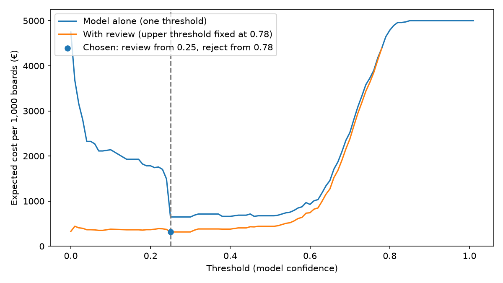

# Assignment 2 Report

- **Name**: Julián Consuegra
- **Student ID**: 19376
- **Email**: jconsuegra.ieu2022@student.ie.edu
- **Group**: BBADBA 5A 

## Business problem, and the cost of being wrong

I decided to focus my project on the manufacturing process  of circuit boards. Circuit boards are flat green boards located inside basically any electronic device. Their main purpose is to act as the "skeleton" of these devices, carrying wires, chips and overall small components that enable proper functionality. The business I will be focusing on is a factory that produces these boards and sells them to electronic manufacturers. Currently, the factory relies on inspectors who personally check the products before they are shipped. Defects are often tiny, and checking every board by eye is slow and tiring, so inspectors can miss them. I will create a model that is able to flag boards that are likely to have a defect, reshaping the human-in-the-loop and introducing human interaction only when the model is unsure. Defects will be treated as the positive class during the detection process. 

This seemed like an interesting opportunity since production lines in this industry must follow strict quality control measures as these boards will ultimately determine if the final product works or not. Also, the cost of a mistake is high compared to other industries such as food or clothing. Since electronic products are usually sold at high prices in the market, a false negative would lead to producing broken phones or computers that result in client dissatisfaction and refund requests. On the other hand, a false positive would not be as costly. A good board would be wasted and the costs incurred would be those of manufacturing it which are minimal or even just a couple of minutes of an inspector depending on the case. Considering this, a false negative could cost approximately 10x to 50x (or more depending on the final product) more than a false positive. To put it in perspective, a board can cost about €5 to make while a refund of a whole device could cost €200 at least (some could even reach €1,000+ depending on brand and device). It is important to know the factory is not in charge of the refund process as the electronic manufacturer is the one facing the client directly, but they will be responsible for a compensation. It is a significant difference that if not managed properly, profit margins of businesses could be directly affected in the long run. Since a missed defect is the worst outcome, a low threshold will be set to avoid false negatives even if there needs to be more human intervention at first involving inspections. The metric to focus on will specifically be recall on defects;lower precision will be accepted considering the ultimate goal. 

## Dataset

Workspace: object-detection-dt-wzpc6
Project: pcb-dataset-defect
Version: 1
Link: universe.roboflow.com/object-detection-dt-wzpc6/pcb-dataset-defect/dataset/1
License: CC BY 4.0

In the chosen dataset, each image are plain circuit boards (with no chips attached yet) with different defects highlighted with boxes sorrounding them. They are very small details represented by these 6 different classes:

1. missing_hole: A hole that should have been drilled and isn't there
2. mouse_bite: Small indents out of the edge of a copper line, making it thinner and weaker
3. open_circuit: A copper line is broken, so electriicty can't pass.
4. short: Two copper lines are joined when they shouldn't be.
5. spur: A small spike of copper sticking out from a line
6. spurious_copper Residue of copper where there shouldn't be any.

The dataset serves the problem directly as the images used show the boards at the stage in which they are sent to electronic manufacturers before any component is added. They reflect real and common defects a board may have after production. However, there are some aspects that need to be considered when assessing how realistic the sample actually is. The dataset is defect-heavy (each image contains at least 1 defect) and in real factories, the majority of boards are fine. Also, there are only about 10 different board designs when in reality, factories are responsible for many more designs. Since the dataset only includes images of boards with defects, it is not certain how often this happens in production and a realistic share of defective boards will have to be assumed when calculating costs. Finally, since the board designs displayed are the same in training and testing, there might be inflated results that will differ when boards with different designs are introduced. Even though the dataset's limitations affect the generalization of results, the information fits the problem. It teaches the model what a defect looks like  and the assumptions made will handle the gaps to make the business impact clear.

## What the dataset's composition implies

| Class           | Train | Valid | Test |
|-----------------|------:|------:|-----:|
| missing_hole    |   360 |    83 |   54 |
| mouse_bite      |   385 |    47 |   60 |
| open_circuit    |   409 |    28 |   45 |
| short           |   397 |    35 |   59 |
| spur            |   372 |    32 |   84 |
| spurious_copper |   380 |    48 |   75 |
| **Total defects** | **2,303** | **273** | **377** |
| **Images**      |   541 |    62 |   90 |

The distribution of instances reflects a good class balance in training. The model will properly learn and practice from the different defects. Any difference in performance between classes later on will come from how hard the defect is to spot, not from lack of examples. When looking at testing, the sample is smaller, with 45-84 defects per class and a total of 90 images. This is important when analyzing per-class results since getting only 2 or 3 right or wrong could alter final metrics more. For example, on 'open_circuits', getting just 2 more defects wrong out of 45 drops recall by about 4 points. This could be defined by chance so when interpreting the results, a small difference will not mean one class is better. Additionally, validation is even smaller, so the progress checks are roguh rather than precise. 

After computing the main statistics about the dataset, I identified that the median defect covers about 0.07% of the image. Even the largest defect is under 1% (0.825%) of the whole image. Evidently, it is a very small portion that could be difficult to spot. Before looking at images, YOLO shrinks the width of them (640 pixels by default) and defects would only be about 15-20 pixels after this. Due to this, during training and testing I will use larger image sizes to ensure proper learning and prevent the model from missing defects. This makes the process longer and it takes up more memory but it should help in performance.

Finally, the test set has the same type of images that the training has. This means that an actual factory scenario isn't fully represented. Every test image comes from the same board designs as training and each board has at least one defect. In a realistic scenario, every board wouldn't necessarily have a defect and many more than about 10 designs would be seen. This means that the scores will reflect how well the model spots defects on boards it has already seen designs of. The test cannot show how well the model deals with board designs that have not been seen or differentiate boards that have no defects at all. Due to this, in a real-world scenario I can expect the scores to be lower considering these limitations. 

## Finetuning and baselines

For this task we need object detection because defects must be identified on the boards, many even have several per image. Considering the defects may be tiny to the naked eye on a board, I decided to use YOLO11s rather than YOLO11n as it is a bigger model, making it better with small objects. Instead of training from scratch, I finetuned the version already trained on COCO, so it already knew general shapes and edges and only had to learn what defects look like, which is why 541 training images were enough. For the training, I used Google Colab (free T4 GPU, image size 1024) configured to run up to 100 epochs with early stopping after 20 without improvement. Due to this, it stopped at epoch 61 after approximately 30 minutes and no improvement since epoch 41. 

**Results Table:**
| Model (test split: 90 boards, 377 defects) | mAP50 | mAP50-95 | Defects found (conf ≥ 0.25) | Boards with a false alarm (conf ≥ 0.25) |
|---|---|---|---|---|
| Finetuned YOLO11s | 0.951 | 0.526 | 94.4% | 7.8% |
| Pretrained COCO YOLO11s, zero-shot | 0.000 | 0.000 | 0.0% | 0.0% |
| Trivial baseline (predicts nothing) | 0.000 | 0.000 | 0.0% | 0.0% |

The last two columns of the results are measures to understand when a defect counts as "found" or "false alarm". For the defect to count as "found", the model must draw a box overlapping the real defect by at least 50%, with at least 0.25 confidence. On the other hand, a "false alarm" is generated when a box drawn with confidence 0.25 or higher doesn't overlap any real defect. Looking at the rest of the results, finetuning generated substantial improvement, going from finding none of the defects to finding 94.4% of them, while raising a false alarm on only 7.8% of boards.

The mAP50 and mAP50-95 evaluate how good the model is at detection at different strictness levels (0 being no good and 1 being perfect). For mAP50, a prediction counts as correct if it identifies a real defect and overlaps at least 50% of the original box. It averages scores throughout all classes and gives a final result. Considering the score from our model, mAP50 = 0.951, it is fair to conclude that it is close to perfect at finding and correctly labelling defects. In contrast, mAP50-95 is more demanding in terms of overlap percentage of the original box as it tests from 50% all the way up to 95% overlap. At the highest value, the box drawn by the model must practically fully overlap the original one. In our case, the value of 0.526 for mAP50-95 means that when extreme precision is required, the score drops significantly. 

Compared to the COCO model and baseline, the gap was as large as expected. These models weren't trained to recognize defects so when presented with a task of detection, it wasn't surprising that they found none. Also, such a high score for the finetuned model is slightly optimistic now that the test boards come from the same board designs as the training ones, as mentioned previously in the report (not 100% realistic). The drop from mAP50 to mAP50-95 is not critical for this situation since the main focus is to flag possible defects instead of placing boxes perfectly around defects. 

## Per-class evaluation and failure modes

**Per-Class Result Table:**
| Defect | Precision | Recall | AP50 | AP50-95 | Test instances |
|---|---|---|---|---|---|
| missing_hole | 0.993 | 1.000 | 0.995 | 0.641 | 54 |
| spurious_copper | 0.979 | 0.933 | 0.981 | 0.565 | 75 |
| open_circuit | 0.977 | 0.926 | 0.962 | 0.448 | 45 |
| mouse_bite | 0.982 | 0.916 | 0.951 | 0.519 | 60 |
| short | 0.961 | 0.932 | 0.933 | 0.496 | 59 |
| spur | 0.983 | 0.857 | 0.887 | 0.487 | 84 |

**Confusion matrix (test split, counts).** Rows are what the model
predicted, columns are the real defect. The last row shows defects
the model missed completely.

| Predicted ↓ / True → | missing_hole | mouse_bite | open_circuit | short | spur | spurious_copper |
|---|---|---|---|---|---|---|
| missing_hole | **53** | 0 | 0 | 0 | 0 | 0 |
| mouse_bite | 1 | **38** | 9 | 0 | 7 | 1 |
| open_circuit | 0 | 5 | **32** | 1 | 0 | 8 |
| short | 0 | 1 | 0 | **51** | 6 | 0 |
| spur | 0 | 15 | 0 | 5 | **60** | 11 |
| spurious_copper | 0 | 1 | 3 | 1 | 5 | **55** |
| missed (background) | 0 | 0 | 1 | 1 | 6 | 0 |

Based on the results, 'Missing_hole' carries the headline number with almost perfect result and an AP50 score of 0.995. The model found 53/54 missing hole defects in the boards with ease since this class is easier to spot based on its properties (large, clear gap) compared to others. 

On the other hand, spur has the lowest AP50 score of 0.887 and recall of 0.857. Evidently, it was the hardest defect to spot since it was the most often missed completely (6 of the 8 defects that were not detected at all are spurs). Considering it is the biggest class in the test set, having this weakness generates a big impact. 

The model is often confused by different types of defects that actually look very similar to the naked eye. This is the main reason why the model is confused, pure appearance. 

- Spurs and mouse bites are confused both ways. There were 15 predictions for spurs that were actually mouse bites and 7 predictions for mouse bites that were actually spurs. They are very similar as one is a small notch into the copper line, and the other is a small spike out of it. 
- Open circuits are often labelled as mouse bites (9 times). A full break and a partial bite look similar
- Spurious copper is sometimes labeled as a spur (11) or an open circuit (8)
- Missing holes and shorts are almost never confused with any other class. 

Even though results may seem imperfect considering some mix-ups between classes, this matters less than it appears. Despite the model mislabelling a mouse bite for a spur, the board will still be flagged and revised. What needs to be monitored are defects that are not identified at all. This causes faulty boards to be shipped and costs to increase. 

## Cost matrix and operating point
Based on research on actual costs of PCB factories and Spanish salaries, I approximated euro cost for each kind of error.

- False Negative: **€100**. Once a defective board ships, the client assembles components onto it, and when it fails the board maker has to compensate the client for those components and the rework. A rule of thumb will be implemented in which the defect gets 10x more expensive at each stage it escapes. So for a €5 board problem, it becomes about €50-100+ once it reaches assembling stages.

- False Positive: **€5**. If a good board is wasted, the cost incurred would be production cost. This is the value of producing a multi-layered board on average based on PCB factory information.

- Inspection: **€0.33**. When inspection is needed due to uncertainty on a board, the cost is calculated based on how much time an inspector takes checking and the average cost incurred by employers for having inspectors in Spain. It takes about 1 minute at around €20/hour would result in a cost of approximately €0.33 per check. 

- Inspectors catch every defect they check. This is optimistic, and it flatters the option of inspecting every board, so the advantage of using the model is, if anything, understated.

- Correct Decisions: **€0**. A correctly discarded board was lost anyway, whatever the model does, so the model doesn't add a cost there. 

- Base rate: **5%**. In an industry survey of PCB companies about what share of bare boards pass inspection, most (64%) reported more than 95%, and another 21% reported 90-95%. I therefore assume 5% of boardsare defective, and also test 2% and 10%.

The most uncertain assumption here is the cost for False Negatives. It highly depends on whether the client catches it in initial testing before adding components (as low as 30 euros) or in the point where the defective board ends up in a finished phone that a customer returns (500 euros or more). Considering this, the threshold decision will be a trade-off between missing defects and paying more for inspections. If a miss is very expensive, the threshold for inspection will be low to make sure there are minimal misses. However, if a miss is cheap, fewer inspections are worth paying and a higher threshold can be set. To address this, I reran the cost sweep with €30 and €500 (results below). 

**How the sweep works.** Each board is judged by its most confident box. Boards scoring below the lower threshold are shipped, between the two thresholds they go to an inspector, and above the upper threshold they are rejected automatically. Since real defective boards usually have a single defect, each defect in the test set is scored as if it were its own board. Because the dataset has no defect-free boards, the behaviour on good boards is estimated from boxes drawn where there is no real defect. The code tries every pair of thresholds from 0.00 to 1.00 and calculates the expected cost per 1,000 boards for each.

**Chosen operating point.** The cheapest pair is:

- Below 0.25: ship
- Between 0.25 and 0.78: send to an inspector
- From 0.78: reject automatically

This costs €316 per 1,000 boards. Most of it (about €279) comes from the 2.8 defective boards per 1,000 that still get shipped, because the model never boxes them at all. The best the model can do alone, with a single threshold and no inspectors, is €648, so adding the inspector band halves the cost.

**Sensitivity.** Testing a miss costing €30 and €500, and 2% and 10%
of boards being defective:

| Cost of a miss | Defective boards | Lower | Upper | € per 1,000 | Sent to inspector |
|---|---|---|---|---|---|
| €30 | 2% / 5% / 10% | 0.25 | 0.78 | 64 / 122 / 217 | 9% / 12% / 15% |
| €100 | 2% / 5% | 0.25 | 0.78 | 142 / 316 | 9% / 12% |
| €100 | 10% | 0.00 | 0.78 | 326 | 99% |
| €500 | 2% / 5% / 10% | 0.00 | 0.78 | 328 to 329 | ~99% |

When misses are cheap or defects are rare, the thresholds do not move at all, so the decision holds. But when a miss costs €500, or 10% of boards are defective, the cheapest option becomes sending almost every board to an inspector. This happens because about 5.6% of defects never get a box from the model, and no threshold can catch a defect the model does not see. So the decision depends heavily on the cost of a miss,and the factory should measure its real compensation costs before relying on the model.

## What a person still has to check
With the thresholds chosen above (inspector from 0.25, automatic rejection from 0.78), 11.5% of boards go to an inspector. At 10,000 boards a day, that is about 1,150 checks a day.

Each check takes about 1 minute, so an inspector working 7 productive hours (an 8-hour shift minus breaks) can check around 420 boards a day.That means about 1,150 / 420 = 2.7 inspectors, so 3 people.

This is realistic. Checking every board today would need about 24 inspectors (10,000 / 420), so the model cuts the team by around 21
people while the remaining inspectors only look at the uncertain boards. The main risk is that 1,150 checks a day is still repetitive
work, and attention drops over a shift, so rotating tasks or splitting the checks across shifts would help.

**Against the alternatives** (expected cost, using the same assumptions):

| Option | € per 1,000 boards | € per day (10,000 boards) | Inspectors |
|---|---|---|---|
| Do nothing: ship every board | €5,000 | €50,000 | 0 |
| Inspector checks every board | €330 | €3,300 | ~24 |
| Model alone: best single threshold | €648 | €6,480 | 0 |
| Model + inspector band (chosen) | €316 | €3,160 | ~3 |

The chosen design is the cheapest, but only slightly cheaper than checking every board (about 4%). In practice it swaps most of the
inspection labour (around €2,900 a day) for the expected cost of the few defects the model misses (around €2,800 a day). This comparison also assumes inspectors never miss a defect. Real inspectors do miss some, especially when checking thousands of boards a day, so the true cost of checking everything is higher, and the advantage of the chosen design is likely larger than shown here.

## Limitations & next steps

- **Same board designs in training and testing.** All images come from about 10 board designs, so the test score is likely optimistic. In order to address this, future tests should be on board designs the model has never seen, ideally photos from the factory's own production line.

- **No defect-free boards.** Every image has at least one defect, sovthe false-alarm rate on good boards could only be estimated from areas without defects. For future testing, it is important to collect photos of good boards from the line and measure how often the model flags them. This is a more realistic approach as factory lines have the majority of boards defect-free.

- **Artificial defects.** The defects in this dataset were added onto the boards on purpose, so real production defects may look different. Retraining and testing on real defective boards will cover this limitation.

- **Uncertain cost of a miss.** The decision flips to checking almost every board when a miss costs €500. By measuring what the
  factory actually pays in compensation per defective board, the sweep can be rerunned with the new value and decisions might be more stable.

- **Inspectors assumed perfect.** Real inspectors miss some defects, which affects both the inspector band and the option of checking
  everything. For future interpretation, an inspectors approximate miss rate could be investigated further to account for possible misses.

- **Small test set per class.** With only 45 to 84 defects per class, small differences between classes are not reliable. Getting a bigger test set would help towards this limitation.

## Generative AI use disclosure
I used Claude for assitance during my project. Specifically, I worked with this tool for: 
- **Understanding Concepts:** Explaining YOLO metrics (mAP, IoU), thresholds and cost sweeps.
- **Research:** Comparing Roboflow datasets and finding sources for the cost figures (inspector salaries, board costs, defect rates).
- **Code:** Writing train.py, app.py and dataset_stats.py.
- **Report:** Reviewing my drafts and proposing alternative wording or focus based on what was being asked. 
